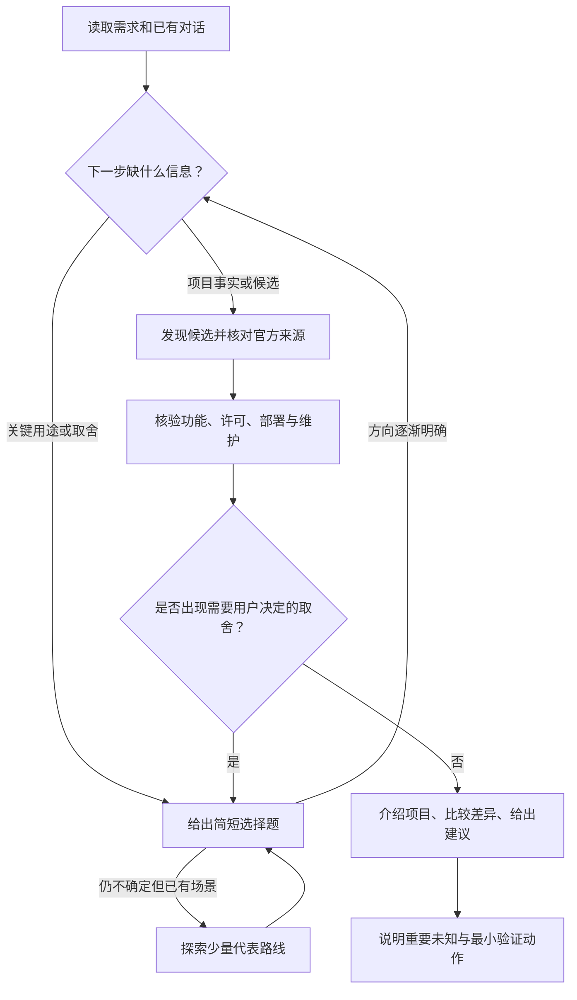

<div align="center">

# 🔭 Open Source Scout

**从模糊想法出发，找到适合你的开源项目。**

渐进需求引导 · 项目发现 · 证据核验 · 比较与选型

[](LICENSE)


**简体中文** · [English](README.en.md)

[快速开始](#快速开始) · [工作流程](#工作流程) · [对话示例](examples/conversations.md) · [参与贡献](CONTRIBUTING.md)

</div>

---

## 它能帮你做什么？

Open Source Scout 是一个面向各类 AI Agent 的通用开源项目检索与选型 Skill。它把“帮我找个开源项目”推进为一份能理解、能比较、能追溯依据的建议。

你可以在支持 Skills 的 Agent 中安装它，也可以让能够读取文件的 Agent 加载它的规则，或将它接入自己开发的 Agent。核心流程以 Markdown 编写，不绑定特定模型、客户端或 Agent 框架。

你不必先写好需求文档。只有一个想法时，它会用选择题帮助你找到方向；已经说清楚用途时，就进入检索。结果中会解释每个项目做什么、如何用于你的场景，以及需要你自己补齐哪些工作。

```text
请使用 open-source-scout Skill 帮我找一个开源的长期记忆模块。
我想给自己的 Agent 使用，但还没想清楚具体方案。
```

| 你现在的情况 | 它怎样帮助你 |
| --- | --- |
| “想做点什么，但不知道该找哪类项目” | 从用途开始给选择题，必要时用代表方案解释路线差异 |
| “目标明确，帮我找几个合适的” | 按条件发现候选，核查功能、许可、部署和维护情况 |
| “这几个项目哪个好？” | 用共同维度比较，说明推荐理由和改选条件 |
| “想找某个产品的开源替代品” | 拆解实际需要的能力，核对替代范围与缺口 |
| “我想学习源码或参与贡献” | 围绕代码、示例、贡献入口和维护者互动评估 |

## 为什么这样设计？

- **先理解用途。** 同样是“知识库”，个人笔记、团队文档和资料问答可能需要完全不同的项目。
- **问题由宽到窄。** 通常每轮只问 1–2 个会影响选择的问题，允许“不确定”和自由补充。
- **信息足够就推进。** 不要求填满所有字段；用户不知道怎么选时，可以先探索真实路线。
- **让用户认识项目。** 简介解释“它是什么、做什么、怎么用”，再谈需求匹配和取舍。
- **把结论连到证据。** 重要判断核查官方文档、许可证、相关实现或发布说明，区分项目声明与实际测试。
- **核查首选的弱点。** 推荐前检查关键能力是否只在商业版、是否需要外部服务，以及接入工作量。

## 快速开始

### 1. 获取 Skill

从 [GitHub 仓库](https://github.com/zHaooJ/open-source-scout-skill) 下载，或克隆到本地：

```bash
git clone https://github.com/zHaooJ/open-source-scout-skill.git open-source-scout
```

核心文件是 `SKILL.md` 和 `references/`，请保持它们的相对位置。完整仓库也可以一起复制；介绍文档无需每次加载。`agents/openai.yaml` 是可选的 Codex 展示元数据，其他 Agent 可忽略。

### 2. 接入你使用的 Agent

| Agent 的接入方式 | 怎样使用 |
| --- | --- |
| 支持 `SKILL.md` / Skills | 按宿主的技能安装机制导入 `open-source-scout` 目录，再用其技能调用方式启动 |
| 能读取本地或工作区文件 | 将目录放到 Agent 可访问的位置，明确要求读取 `SKILL.md`，并按其中指引读取 `references/` |
| 自己开发的 Agent | 将 `SKILL.md` 作为任务规则入口，按阶段加载参考文档，接入搜索、来源读取和用户问答能力 |

不同宿主的安装目录、调用语法和工具接口可能不同。下面的自然语言示例用于表达意图；使用前需完成规则加载或技能安装。

<details>
<summary>安装示例：Codex</summary>

将包含 `SKILL.md` 的 `open-source-scout` 目录放入 Codex 的个人技能目录。

| 系统 | 默认路径 |
| --- | --- |
| Windows | `%USERPROFILE%\.codex\skills\open-source-scout\` |
| macOS / Linux | `~/.codex/skills/open-source-scout/` |

如果设置了自定义 `CODEX_HOME`，使用其下的 `skills/open-source-scout/`。已有同名 Skill 时，先保留自己的修改再更新。

安装后应能直接找到以下文件，避免多套一层下载目录：

```text
skills/
└── open-source-scout/
    ├── SKILL.md
    ├── agents/openai.yaml
    └── references/
```

在 Codex 中，可以用 `$open-source-scout` 调用。未被识别时，先确认目录名和 `SKILL.md` 的位置，再尝试新建会话或重启客户端刷新技能发现。具体加载方式以所用 Codex 版本为准。

</details>

### 3. 在聊天中使用

```text
请使用 open-source-scout Skill 帮我找几个开源 Agent harness。
我要开发自己的通用 Agent，语言暂不限。
```

也可以直接给出比较要求：

```text
请使用 open-source-scout Skill 比较我提供的这几个仓库。
重点看是否能自托管、开源版功能，以及接入现有系统的工作量。
```

对于通过文件接入的 Agent，可以这样开始（路径替换为实际位置）：

```text
请读取工作区中的 open-source-scout/SKILL.md，
并按其中指引读取 references/ 下的相关文档，使用这套流程帮我寻找开源项目。
我的需求是……
```

### 4. 根据需要补充选择

关键用途不明确时，Skill 会先提问。你可以选择一个方向、自由补充，或说“暂不确定，先给我看几条路线”。已经明确的条件会沿用，不必每次重填。

## 一次交互是什么样？

> **以下为流程演示，不是一次实时检索结果。** 提问根据上下文变化，不是固定问卷。

**你：** 帮我找个开源长期记忆模块。

**Scout：** 这个模块最优先要记住什么？（单选，也可以补充）

- A. 用户：偏好、习惯和个人背景
- B. 任务：长期项目的进展、决策和待办
- C. 经验：哪些做法有效、哪些问题要避免
- D. 不确定，先看区别

**你：** B，给我自己的 Agent 使用。

**Scout：** 项目发生变化时，希望怎样更新？

- A. 通过任务工具明确更新状态
- B. 从对话和执行记录中自动提取
- C. 两者结合，明确状态优先
- D. 先解释这些方式的差别

**你：** C。语言和部署暂不限。

**接下来：** 将这些条件用于检索，核查候选是否能处理状态变化、保留决策来源、接入现有 Agent，再比较项目。若没有单一模块满足需求，会解释需要组合的部分，而不把组件说成完整方案。

[查看更多场景与示例输出 →](examples/conversations.md)

## 工作流程



这些是可以切换的工作方式，不是每次必须走完的固定步骤。需求已经清楚时直接搜索；明确要求“少问，先给方向”时先提供探索候选。详见[流程与判断原则](docs/workflow.md)。

## 你会得到什么？

结果随任务调整。多个候选通常会包含以下信息：

| 内容 | 回答的问题 |
| --- | --- |
| 项目简介与链接 | 它是什么？主要解决什么问题？ |
| 当前需求中的角色 | 能直接使用，还是需要接入、开发或组合？ |
| 共同维度的比较 | 各项目在能力、依赖和投入上有什么差别？ |
| 来源与核查范围 | 判断来自文档、实现检查，还是运行观察？ |
| 选择总结 | 优先考虑谁？什么情况下改选？ |
| 未知与下一步 | 哪个缺口可能改变结论？怎样用小验证解决？ |

不会为了凑数量扩充清单，也不会把 star 数或没有依据的总分当成选型结论。

## 运行条件与能力边界

- **这是指导 Agent 工作的 Skill。** 仓库本身不包含独立搜索引擎、模型服务或项目索引。
- **实时检索需要宿主提供联网能力。** 可使用公开网页搜索、仓库连接器和官方文档读取等工具；没有固定 MCP、API Key 或模型要求。
- **没有联网能力时仍能澄清需求、分析给定材料。** 结果会注明范围，不能称为实时搜索或最新核验。
- **面向各类 Agent，接入方式由宿主决定。** 宿主需能加载规则和参考文档，并支持多轮对话；选择题可通过交互控件或普通文本呈现。本仓库未逐一验证所有宿主的自动发现与调用方式。
- **搜索结果不等于运行成功。** 检索请求默认不包含安装候选、运行代码、部署或联系维护者；这些动作按实际授权另行开展。
- **这是工作规则，不是结果保证。** 覆盖面和判断质量受模型、工具、资料可得性以及任务条件影响。

## 仓库结构

```text
open-source-scout/
├── README.md                       中文首页与快速开始
├── README.en.md                    English overview
├── SKILL.md                        Skill 入口与核心规则
├── agents/openai.yaml              可选的 Codex 展示信息与默认提示
├── references/
│   ├── intake.md                   动态需求访谈
│   ├── search-and-evidence.md      检索与证据核验
│   └── comparison-and-delivery.md  比较、交付与反馈
├── docs/
│   ├── workflow.md                 流程解释与设计取舍
│   └── publishing.md               仓库发布说明
├── examples/conversations.md       对话与交付示例
├── .github/                        Issue 与 PR 模板
├── CONTRIBUTING.md                 贡献指南
├── CHANGELOG.md                    变更记录
└── LICENSE                         MIT 许可
```

## 参与贡献

欢迎提供脱敏后的真实使用场景、发现漏检的路线，或改进提问和比较方式。最有价值的反馈是“什么请求下，出现了什么可观察的问题”。

请先阅读 [CONTRIBUTING.md](CONTRIBUTING.md)。发布自己的仓库可参考[发布说明](docs/publishing.md)。

## 设计参考

检索深度、来源角色、证据复用和代码库比较思路参考了 [CCFA-Skills](https://github.com/mikubaka88/CCFA-Skills) 中的[文献检索](https://github.com/mikubaka88/CCFA-Skills/tree/main/ccf-literature-searcher)与[代码库选型](https://github.com/mikubaka88/CCFA-Skills/blob/main/ccf-research-engineer/references/codebase-and-implementation.md)。需求访谈与开源项目选型规则独立编写，运行不依赖该仓库。

## 许可证

本仓库以 [MIT License](LICENSE) 发布。被检索项目和外部参考资料各自遵循其自身许可。
